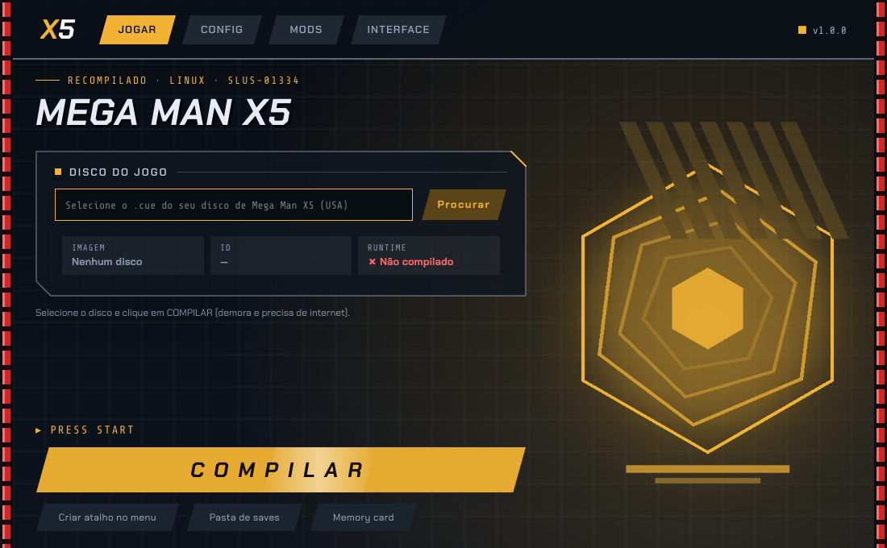
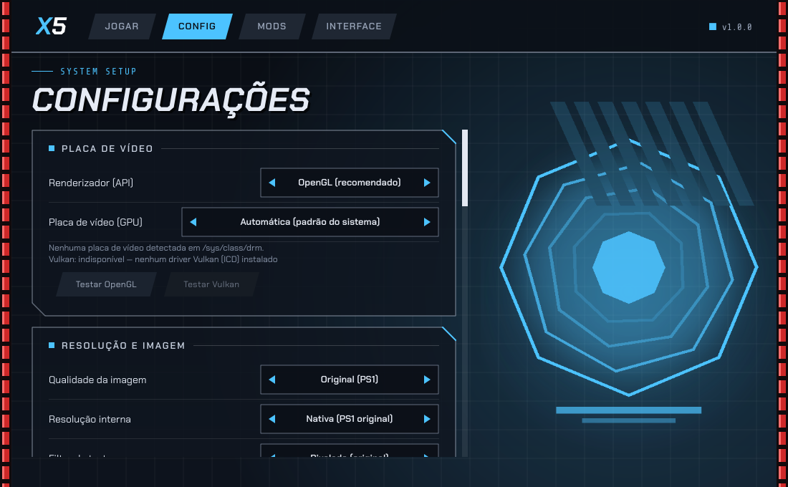
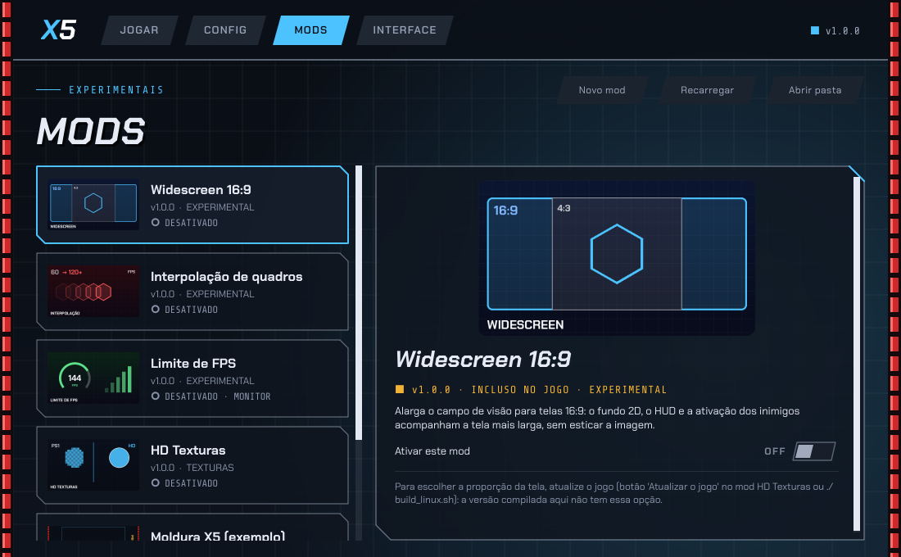

# Mega Man X5 Recompiled — launcher para Linux

> **EN:** An unofficial Linux launcher + build script for the community static recompilation of *Mega Man X5* (PS1,
> [mstan/MegaManX5Recomp](https://github.com/mstan/MegaManX5Recomp)). You provide your own disc image; nothing from the
> game is distributed here. Non-commercial use only (see *Licenças*). Documentation below is in Portuguese.

Launcher gráfico, script de compilação e ferramentas para jogar **Mega Man X5** nativamente no Linux, a partir do
projeto de recompilação estática do X5. **Você precisa do seu próprio disco** (`.cue` + `.bin`, versão USA, SLUS-01334).
Este repositório não contém o jogo, nem BIOS retail, nem arte do jogo.



## O que tem

- **Launcher** com abas JOGAR · CONFIG · MODS · INTERFACE, transições, tema personalizável e botão de **compilar o jogo** (baixa o código, compila e instala em `game/`).
- **Configurações gráficas:** resolução interna (nativa → 8K), filtros (xBR, bilinear), FMV, tela cheia, V-Sync, CRT/scanlines.
- **Placa de vídeo:** escolha da GPU (dedicada/integrada/CPU), renderizador **OpenGL**, **Vulkan** (experimental, se o sistema tiver) ou software; botões de teste.
- **Controle:** assistente de mapeamento para controles genéricos ("USB gamepad"), teste dos botões e seleção Jogador 1 (automático/controle/teclado).
- **Mods:** Widescreen (com opção de proporção), Interpolação de quadros, Limite de FPS, **HD Texturas** (capturar → ampliar com IA → carregar), bezel e mods de patch de bytes. Pasta `mods/` funcional: veja [`mods/LEIA-ME.md`](mods/LEIA-ME.md).
- **Diagnóstico:** relatório pronto para colar num problema do GitHub, log do último jogo, resumo da última partida.

<p> </p>

## Como usar

**Requisitos:** Linux x86_64, internet na primeira compilação, ~5 GB livres, o seu disco do jogo.

1. Baixe o `.tar.gz` mais recente em **Releases** e extraia.
2. Instale as ferramentas de compilação (uma vez):
   - Debian/Ubuntu: `sudo apt install build-essential git python3 cmake ninja-build pkg-config libgl1-mesa-dev libx11-dev libxext-dev libxcursor-dev libxi-dev libxrandr-dev libxss-dev libwayland-dev libxkbcommon-dev libasound2-dev libpulse-dev libudev-dev libdbus-1-dev libxcb-cursor0`
   - Fedora: `sudo dnf install gcc-c++ git python3 cmake ninja-build pkgconf-pkg-config mesa-libGL-devel libX11-devel libXext-devel libXcursor-devel libXi-devel libXrandr-devel wayland-devel libxkbcommon-devel alsa-lib-devel pulseaudio-libs-devel systemd-devel`
   - Opcional, para Vulkan: `libvulkan-dev glslc` (Debian/Ubuntu) ou `vulkan-headers vulkan-loader-devel glslc` (Fedora).
3. Rode `./MegaManX5-Launcher`, aba **JOGAR**, escolha o seu `.cue`, clique **COMPILAR** (demora; é feito uma vez).
4. Depois: **READY?** para jogar. `./MegaManX5-Play` abre o jogo direto, sem launcher.

Sem terminal gráfico: `./build_linux.sh --disc "/caminho/Mega Man X5 (USA).cue"`.

> Binário precisa de glibc ≥ 2.35 e, em alguns sistemas, de `libxcb-cursor0`. Alternativa: `launcher/run_launcher.sh` (usa o Python do sistema).

## Atualizando de uma versão antiga
Copie os arquivos novos por cima da pasta antiga (sua pasta `game/`, `mods/` e configurações ficam). Se o launcher avisar que o jogo
foi compilado com um framework antigo, use o botão **Atualizar o jogo (recompilar)** na aba MODS → HD Texturas. O jogo anterior
fica guardado em `game/backup-antigo/`.

## Arte personalizada (opcional)
O launcher vem com arte neutra. Para usar imagens suas, crie a pasta `launcher_art/` ao lado do launcher com `zero.png`, `x.png`
e `sigma.png` (PNG com fundo transparente) e, se quiser legendas, um `art.json`:
`{"zero": ["texto pequeno", "TEXTO GRANDE"], "x": ["", ""], "sigma": ["", ""]}`. Essas imagens ficam só no seu computador.

## Problemas conhecidos
Veja [`docs/KNOWN_ISSUES.md`](docs/KNOWN_ISSUES.md) — inclui os detalhes visuais do mod Widescreen em algumas fases.
Para relatar algo: aba CONFIG → **Gerar relatório de diagnóstico** e abra uma *issue* com o modelo.

## Desenvolvimento
```bash
scripts/qa.sh            # verificações (sintaxe, testes, abre o launcher em modo offscreen)
scripts/qa.sh --online   # + baixa o projeto/framework e aplica os patches (build_linux.sh --dry-run)
scripts/package_release.sh v1.0.0   # gera dist/*.tar.gz (precisa de PySide6 + pyinstaller)
```
`build_linux.sh` baixa o projeto do X5 em um commit fixado e aplica `patches/*.patch` (hoje: opção de proporção do widescreen).

## Créditos
Recompilação do X5, framework `psxrecomp` e `recomp-ui` por **Matthew Stanley (mstan)** e colaboradores. Este repositório
contém apenas o launcher, scripts, ferramentas e mods de exemplo. Fontes: Chakra Petch, Share Tech Mono, Silkscreen (OFL).

## Licenças
- Código deste repositório: **MIT** (`LICENSE`).
- Projeto do X5, framework e recomp-ui (baixados no build): **PolyForm Noncommercial 1.0.0** → **uso não comercial**.
- Detalhes e dependências em [`THIRD_PARTY_NOTICES.md`](THIRD_PARTY_NOTICES.md).
- *Mega Man* é marca da Capcom. Projeto **não oficial**, sem afiliação. Não distribua o jogo, a BIOS nem imagens de disco.
